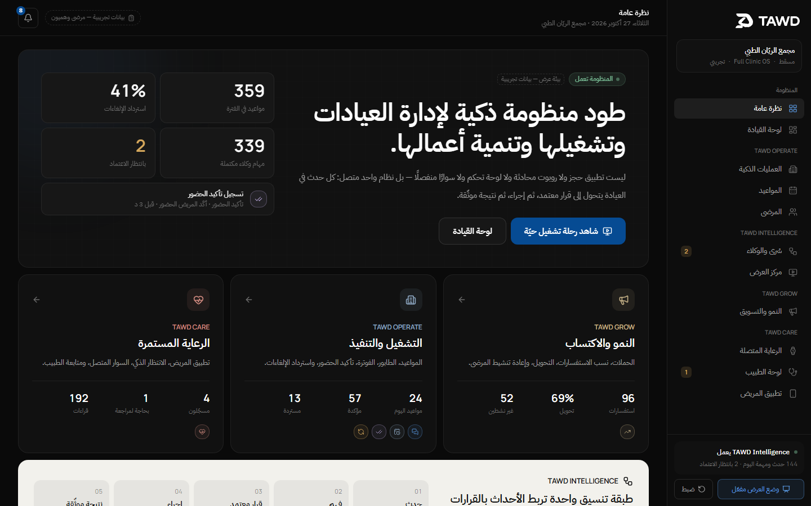
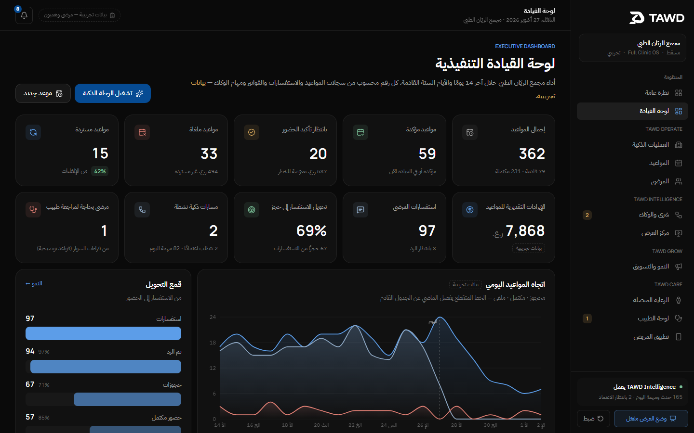
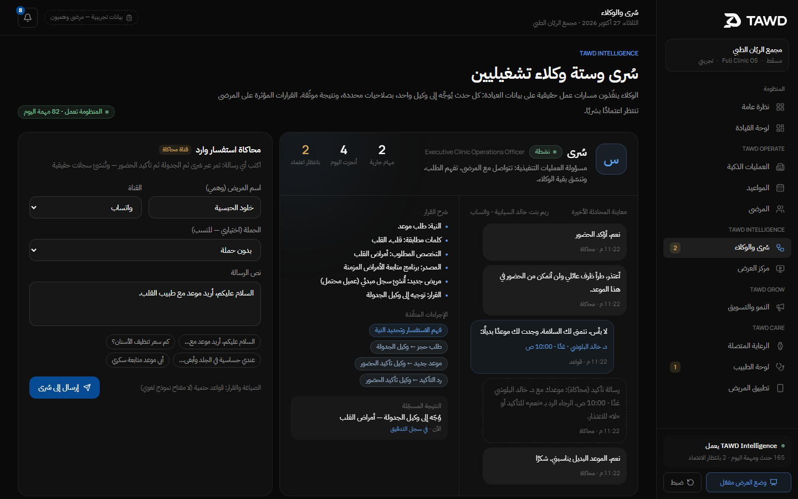
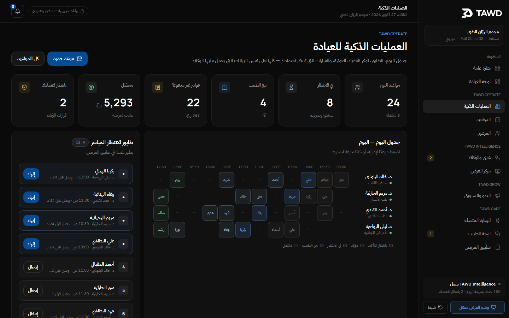
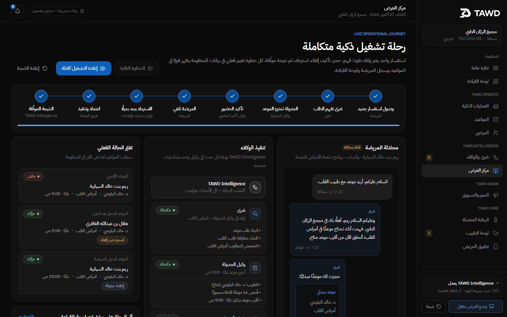
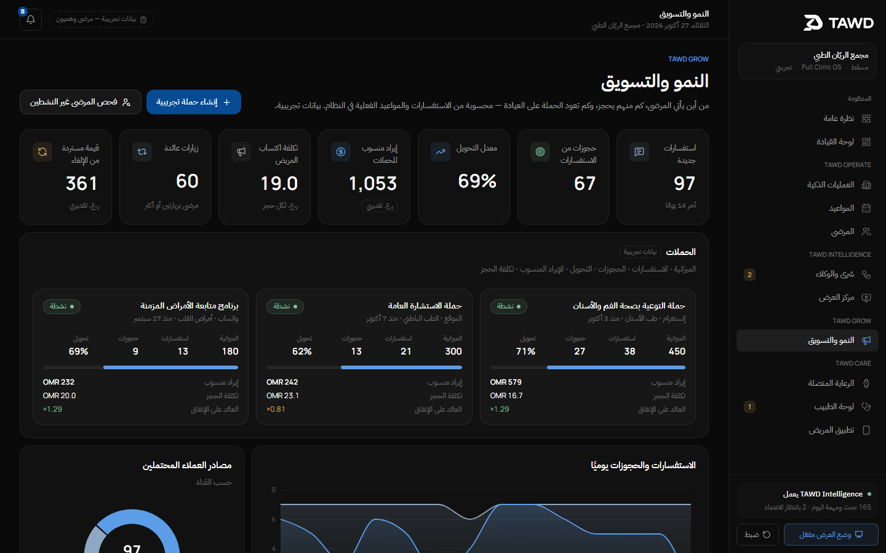
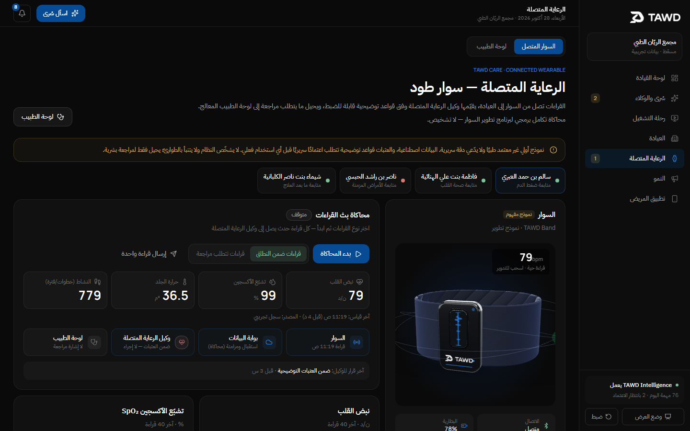
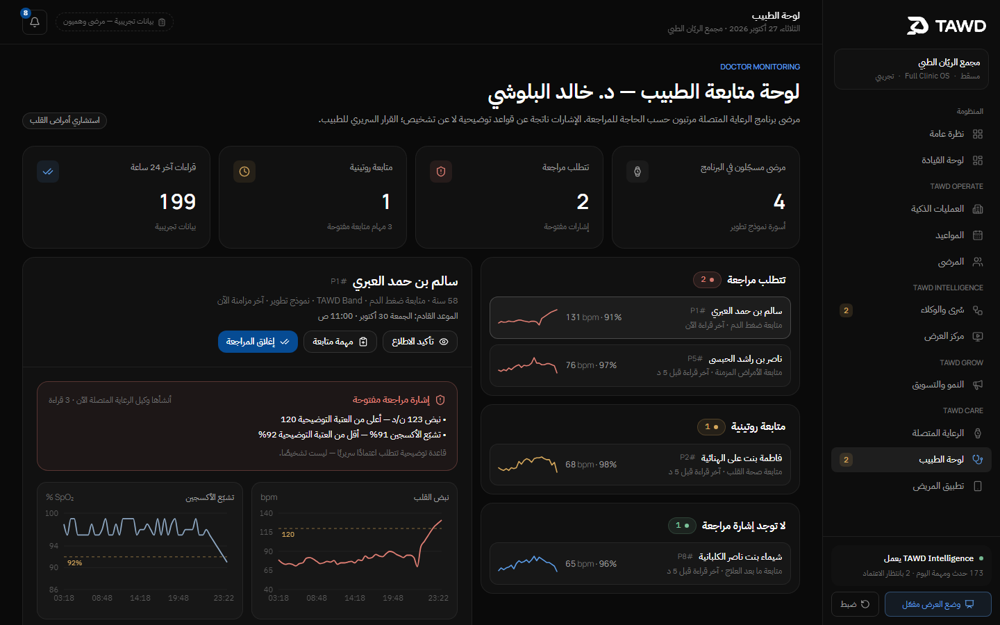
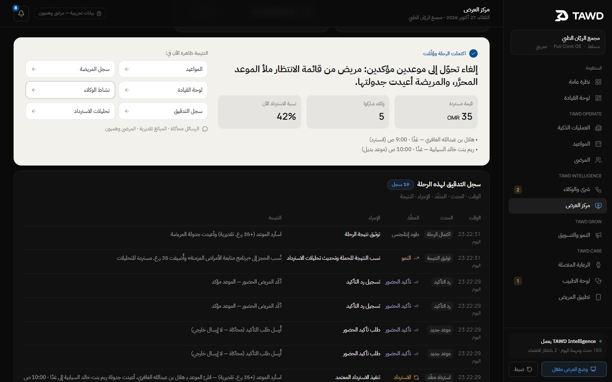
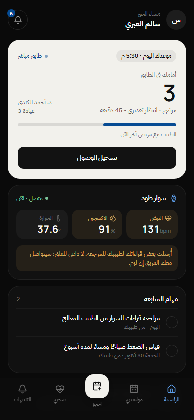

# TAWD | طود — Connected Clinic Ecosystem MVP

**Live demo:** https://mohamad-albadi.github.io/tawd-ecosystem-mvp/ · start with the live journey at
https://mohamad-albadi.github.io/tawd-ecosystem-mvp/demo/ (data stays in your browser; the «ضبط» button resets it).

A working, local-first demonstration of TAWD: one connected system for private clinics that combines
**TAWD Grow** (acquisition and retention), **TAWD Operate** (appointments, queue, billing, attendance,
cancellation recovery), and **TAWD Care** (patient app, connected wearable, doctor follow-up). All three are
coordinated by **TAWD Intelligence**, an orchestration layer that turns every clinic event into
*event → understanding → approved decision → action → verified outcome*.

Every number on every screen is computed from the underlying records. Every button performs a real local
state change. All patients, messages, amounts and readings are synthetic.

## Screenshots

Real browser captures, taken after each workflow ran (higher-resolution set in `screenshots/hd/`).

| | |
| --- | --- |
|  |  |
|  |  |
|  |  |
|  |  |
|  |  |

---

## Run it

Requirements: Node.js 22.

```bash
npm install
npm run build
npm start            # http://localhost:3220
```

For development with hot reload: `npm run dev` (also port 3220).

No database, credentials or paid API are required. State lives in the browser (`localStorage`, key
`tawd-ecosystem`) and is seeded deterministically.

## Pages

| URL | Module |
| --- | --- |
| http://localhost:3220/ | Ecosystem overview (Grow · Operate · Care · Intelligence) |
| http://localhost:3220/dashboard | Executive dashboard: 10 KPIs and 5 charts, all derived from records |
| http://localhost:3220/demo | **Live journey**: inquiry → booking → confirmation → cancellation → recovery → outcome |
| http://localhost:3220/agents | Sura plus the six agents: orchestration map, permissions, task board, audit trail, inquiry simulator |
| http://localhost:3220/operations | Today's schedule grid, live queue, doctor availability, approvals, billing, operational tasks |
| http://localhost:3220/appointments | Appointment list: create, confirm, check in, complete, cancel, reschedule |
| http://localhost:3220/patients | Patient registry with a full record drawer (`?id=p1`) |
| http://localhost:3220/growth | Campaigns, funnel, lead sources, CPA, ROAS, return visits, recovery analytics, reactivation |
| http://localhost:3220/care | Connected wearable: live simulated stream, thresholds, care-agent pipeline |
| http://localhost:3220/doctor | Doctor monitoring: priority groups, trends, acknowledge, follow-up, close review |
| http://localhost:3220/patient-app | Mobile patient app (best at 390 × 844): booking, queue, wearable, follow-ups, notifications |

## The main demonstration (`/demo`)

1. Open **مركز العرض** (`/demo`).
2. Click **تشغيل الرحلة كاملة** to run all 8 steps automatically, or **الخطوة التالية** to advance one
   step at a time. In step mode, step 7 waits for you to approve the recovery agent's proposal.
3. Watch the three live panels: the patient conversation, the agent execution pipeline, and the actual
   appointment records changing (pending → confirmed → cancelled; waiting-list patient fills the slot;
   original patient rescheduled).
4. At step 8 the outcome panel links to the same result in Appointments, the patient record, the
   Dashboard, the Agents board, the Audit trail and Recovery analytics.
5. **إعادة الضبط** restores the seed, so the journey can be repeated indefinitely.

Second key moment: on `/care`, choose **قراءات تتطلب مراجعة**, then **بدء المحاكاة**. Within a few
readings the Connected Care Agent raises a review. Open **لوحة الطبيب** (`/doctor`) to acknowledge it, create
a follow-up, and close it. Every step is audited.

## Reset

- Sidebar → **ضبط** → confirm. This restores the original seeded data across every module.
- If the data was seeded on an earlier day, a banner offers **مزامنة التواريخ**. Seed dates are relative to
  the day of the reset, so "today" always has a schedule and a queue.
- **وضع العرض** (presentation mode) hides technical identifiers for clean screenshots.

## What is genuine and what is simulated

**Genuine local workflows (real state changes, enforced in code):**

- **Event orchestrator** (`lib/engine/orchestrator.ts`). Routes each domain event to exactly one agent and
  enforces per-agent permissions in the engine (not in prompts). It de-duplicates events by key, caps
  iterations to prevent loops, and audits every action.
- **Double-booking guard** (`isTaken` in `lib/engine/core.ts`). It is shared by staff, Sura, the patient app
  and the recovery agent.
- **Appointment lifecycle**: pending → confirmed → checked in → with doctor → completed (creates an invoice)
  / cancelled / no-show.
- **Recovery**: it matches the waiting list, finds an alternative slot, and **waits for human approval**
  before filling or moving any booking.
- **Wearable rules**: configurable illustrative thresholds create a doctor review and a follow-up task.
  There is no diagnosis.
- **Growth**: campaign attribution, conversion, CPA and ROAS are computed from inquiries and appointments.
  Outreach drafts require approval.
- **KPIs** are calculated from records on every render (`lib/engine/kpis.ts`).

**Simulated (clearly labelled in the UI):**

- WhatsApp / Instagram channels and the messages sent to patients. Nothing leaves the browser.
- Patient replies inside the scripted journey, and replies to approved outreach.
- Wearable data: a software integration simulation for the band development programme. It is not a
  certified device and makes no accuracy, detection or prediction claims. ECG is shown as a planned
  capability only.
- Sura's language understanding is deterministic keyword rules, shown to staff as a decision trail.

**Optional AI wording:** if `OPENAI_API_KEY` is set on the server (see `.env.example`), the inquiry simulator on
`/agents` asks the model to re-phrase Sura's reply via `/api/sura`. The model only rewrites wording. It
cannot book, cancel or change records. The key is read server-side only and never sent to the browser.
Without a key, the UI says the replies are rule-based.

## Tests

The end-to-end suite drives the real UI in Chromium and then reads the persisted store to prove the
state changed:

```bash
npm run build && npm start                       # in one terminal
PLAYWRIGHT_PATH=<dir>/node_modules/playwright npm run test:e2e
```

It covers 12 checks:

- seed coherence and no double booking;
- all 11 routes render with no console or page errors;
- the full journey and its outcome showing up across modules;
- the double-booking refusal;
- wearable → care agent → doctor review → acknowledge → close;
- patient-app booking → clinic schedule;
- staff cancellation → recovery proposal;
- persistence across refresh;
- reset → seed restored;
- the journey repeated after reset.

Screenshots: `npm run screenshots` writes `screenshots/01…10` at 1440×900 (the patient app at 390×844).
`SCALE=2 npm run screenshots` writes a retina set to `screenshots/hd/`. Both scripts execute the workflows
before capturing.

## Project structure

```
app/(clinic)/…        staff product pages (shared sidebar shell)
app/patient-app/      standalone mobile patient app
app/api/sura/         optional server-side AI wording adapter
components/           UI kit, charts (Recharts), shell, care, agents, operations
lib/data/seed.ts      deterministic synthetic clinic (4 doctors, 8 featured + registry patients, 3 campaigns, 4 wearables)
lib/engine/core.ts    domain operations + double-booking guard
lib/engine/orchestrator.ts  TAWD Intelligence: routing, permissions, six agent handlers, approvals
lib/engine/kpis.ts    all metrics, derived from records
lib/engine/demo.ts    the 8-step live journey
lib/store/            zustand store persisted to localStorage + UI actions + wearable stream
types/                domain model
tests/                Playwright e2e + screenshot capture
```

## What production would need

- A server database with tenant isolation and audit retention, replacing browser storage.
- Authentication and role-based access (reception, doctor, admin, patient).
- Authorized messaging integrations (for example, the WhatsApp Business API) with patient consent, opt-out
  and templates.
- For the *Intelligent Operations Layer* model: authorized APIs into the clinic's existing system.
- Wearable: hardware, firmware, secure device pairing, a data pipeline, and clinical validation of any
  thresholds under the applicable medical-device regulations before clinical use.
- Clinical governance: thresholds approved by clinicians, human review for every clinical action, and no
  automated diagnosis or treatment.
- An LLM layer (optional) behind the same permission engine, with evaluation and monitoring.

This MVP makes no claim of regulatory certification or medical accuracy, and no claim of integration with
any national health system.
